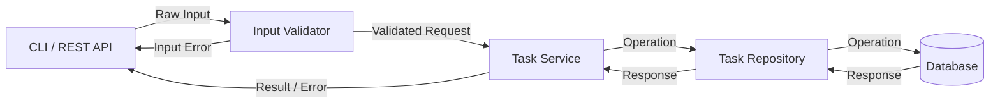

# Technical Spec for Task Tracker

Author: Andy Wang

## Introduction

### Problem Description

Users often have issues keeping track of tasks, as it is often on paper or decentralized in various areas like the notes app or a post it note. Thus, a CLI task manager that's lightweight and easy to use is something that is drastically useful

### Product and Technical Requirements

- Users can add new tasks, view existing tasks, updating certain tasks, complete, and delete tasks
- Interfaces are clear and operations are easily differentiable from one another
- Certain destructive operations like delete, complete should be idempotent
- Data integrity is important, operations should be atomic, failed operations should have fallbacks to prevent data loss
- Project can become an executable or be easily ran by the user

### Non-goals and Out of Scope

- Multimodal attachments for tasks is not relevant for now
- Input methods other than keyboard and maybe mouse
- Hosting or deploying in a virtual environment for mass distribution, since this project is mainly for learning purposes
- Multiple users

### Future goals

- Language specific extensions, if it makes sense, found in `./(Language Name)/extension.md`

## Solutions

### Data Model

#### Task
| Name | Type | Required | Description |
|------|------|----------|-------------|
|ID    |UUID  |Yes       |identifier for task|
|Title |Text|Yes       |human readable identifier for task|
|Status|Text|Yes       |the stage the task is in|
|Description|Text|No   |a description of the task|
|Due Date|Time|No|due date for the task|
|Priority|(Non negative) Number|No|the priority for the task, lower is more urgent, with 0 being most|
|Tags|[Text]|No|a list of optional qualifiers for the tasks, to help with grouping|

#### Operation
| Name | Type | Required | Description|
|------|------|----------|------------|
|Type  |Text  |Yes       |the type of operation being performed|
|OperationID    |UUID  |Yes       |the identifier for the operation|
|TaskID         |UUID  |Yes       |the identifier for the target task|
|Field          |Text  |Yes       |the field in question for the target task|
|Body           |JSON|Yes       |the body of the operation, the information that is being changed|

#### Validation
Each data operation, before being performed, is validated for invalid inputs or injection attempts, attached to the model itself

### Business Logic

#### Data Flow Diagram

### Interfaces
Arguments will be position based, but flags can be used to bypass order

#### CLI
| Command | Description |
|---------|-------------|
|add      |creates a new task|
|list     |view all non-deleted tasks|
|update   |modify an existing task|
|delete   |remove an existing task|
|complete |completes a task|

#### add
**Requires:**
- Title
- Status

**Optional:**
- Description
- Due Date
- Priority
- Tag(s)

#### list
**Requires:**
None

**Optional:**
- Sort (Field) (Value)
Fields allowed:
1. Title
3. Due Date
4. Priority
Values allowed:
1. ascending
2. descending

- Filter (Field) (Value)
Fields allowed:
1. Title (equals)
2. Status (equals)
3. Description (contains, equals)
4. Due Date (equals)
5. Priority (equals)
6. Tags (contains, equals)
 
Tiebreakers are handled lexicographically ascending

Normal sorting order: Status -> Priority -> Due Date -> Title -> Description

#### update
**Requires:**
- Title
- Field

#### delete
**Requires:**
- Title

#### complete (a wrapper of update)
**Reuires:**
- Title

### Testing Plan

- Unit testing for each small piece like functions, happy path, along with ways to fail
- Integration testing for expected behaviors of larger flows like commands
- Manual testing for overall CLI UX

#### Error handling
Error codes are not shown to the user. Processed internally before outputting a user viewable message,
Centralized error handler?

## Timeline & Milestones

Note: May be subject to change depending on language specific requirements

1. Create basic interface
2. Set up database and operations
3. Basic user command parsing
4. Create commands one by one
5. Input refinements, testing